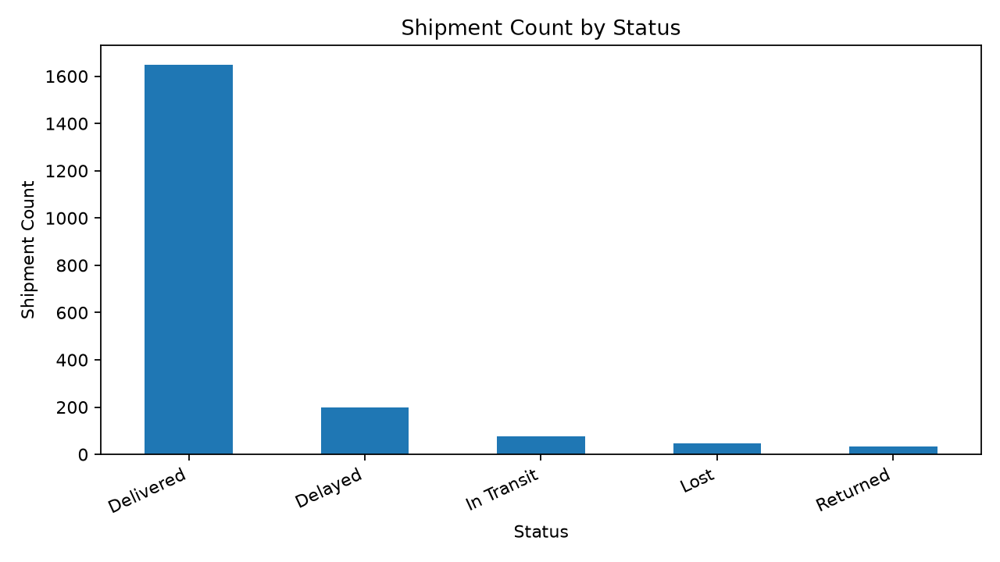
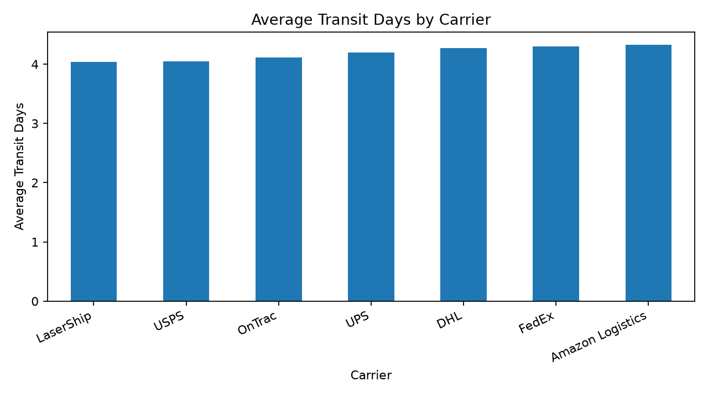
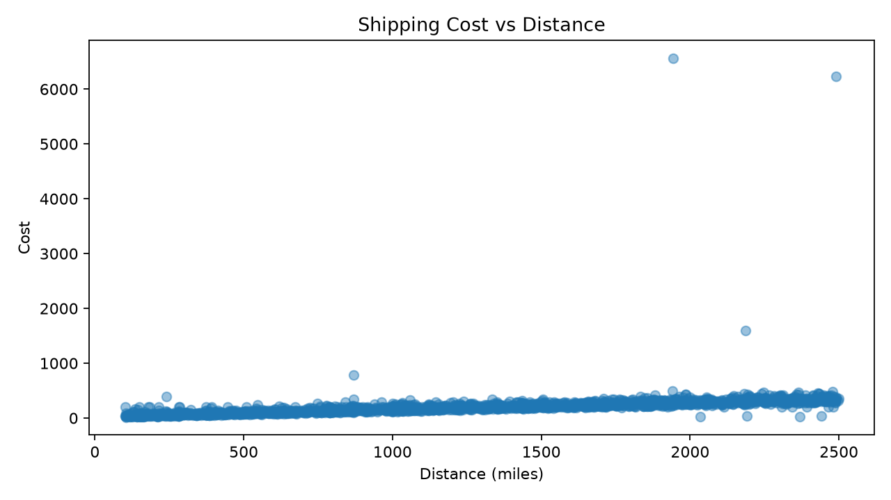
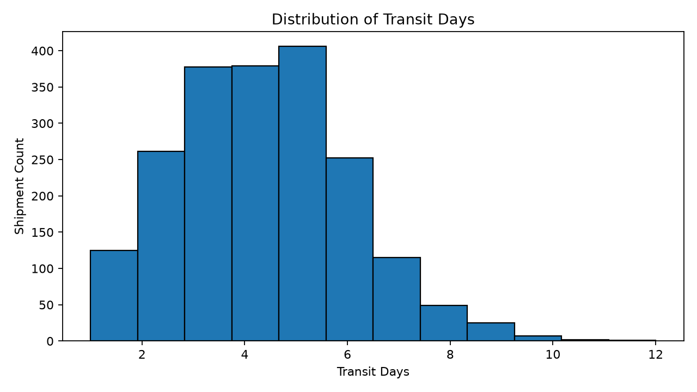
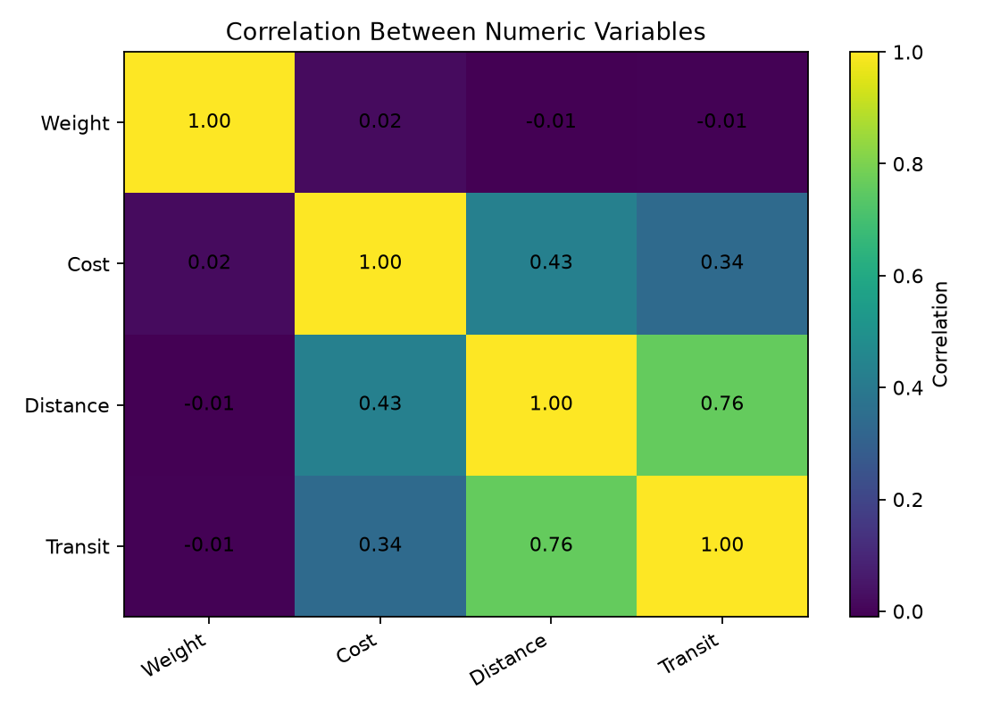

# Week 3 — Advanced Data Analysis and Visualization in Logistics

**Internship:** Yuvaintern Data Analytics  
**Project:** Logistics Shipment Analysis  
**Tools:** Python, pandas, NumPy, Matplotlib

## 1. Project Objective

Explore shipment data, calculate descriptive statistics and correlations, create visualizations, and explain how findings can support data-driven logistics decisions.

## 2. Dataset Overview

The dataset contains **2,000 rows and 12 columns**, including shipment ID, origin warehouse, destination, carrier, shipment and delivery dates, weight, cost, status, distance, and transit duration.

Initial checks found **41 missing Cost values** and **32 missing Delivery_Date values**. Missing Cost values are filled with the median only in a separate `Cost_Analysis` column for calculations. The original `Cost` column is preserved. Missing delivery dates are not fabricated.

## 3. Key Results

| Metric                       |        Result |
| ---------------------------- | ------------: |
| Total shipments              |         2,000 |
| Delivered                    | 1,648 (82.4%) |
| Delayed                      |   199 (10.0%) |
| In Transit                   |            76 |
| Lost                         |            45 |
| Returned                     |            32 |
| Mean transit duration        |     4.18 days |
| Median transit duration      |     4.00 days |
| Cost–distance correlation    |          0.43 |
| Cost–weight correlation      |          0.02 |
| Transit–distance correlation |          0.76 |

These are descriptive findings. Correlation indicates association, not causation.

## 4. Visualizations

The charts are stored in the `charts` folder. Keep the folder in the same location as this README so GitHub can display the images.

### A. Shipment Count by Status



This chart compares shipments marked Delivered, Delayed, In Transit, Lost, and Returned.

### B. Average Transit Days by Carrier



This chart compares average transit duration by carrier. Consider route length, shipment weight, destination, and service type before concluding that one carrier performs better.

### C. Shipping Cost vs Distance



This scatter plot explores the relationship between shipment distance and cost. Other factors such as weight, carrier, route, and service level may also affect cost.

### D. Distribution of Transit Days



This histogram shows common transit-time ranges and helps highlight unusually long durations.

### E. Correlation Heatmap



The heatmap summarizes linear relationships among weight, cost, distance, and transit duration. Correlation alone does not establish causation.

## 5. How to Run the Python Script

Keep `logistics_analysis.py` and `logistics_shipments_dataset.csv` in the same folder.

Install dependencies:

```bash
pip install pandas numpy matplotlib
```

Run:

```bash
python logistics_analysis.py
```

The script generates chart images in `charts/` and summary CSV files in the project folder.

## 6. Recommendations

- Review delayed shipments by carrier, warehouse, destination, and distance.
- Monitor delayed, lost, and returned shipment counts over time.
- Compare cost per mile or cost per kilogram while considering shipment and service differences.
- Validate missing or inconsistent records before calculating final KPIs.
- Investigate unusual values rather than automatically deleting potential outliers.

## 7. Repository Files

- `Week3_Advanced_Data_Analysis_and_Visualization_Report.docx` — detailed report with embedded charts.
- `logistics_analysis.py` — Python analysis script.
- `logistics_shipments_dataset.csv` — source dataset.
- `charts/` — five chart images embedded in this README.
- `shipment_status_summary.csv` — status counts.
- `carrier_performance_summary.csv` — carrier summary.
- `warehouse_summary.csv` — warehouse summary.
- `correlation_matrix.csv` — correlation results.

## 8. Conclusion

This project uses exploratory data analysis and visualization to summarize shipment outcomes, compare transit duration, explore cost-distance relationships, and identify areas for further operational review. The report, code, charts, and summary files support a reproducible workflow.
