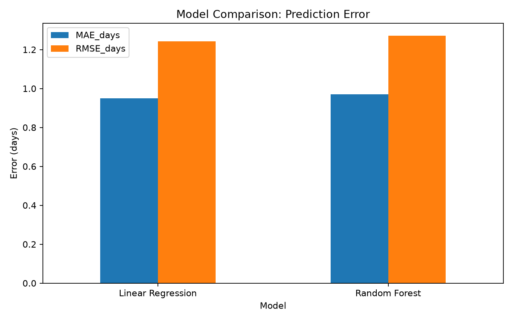
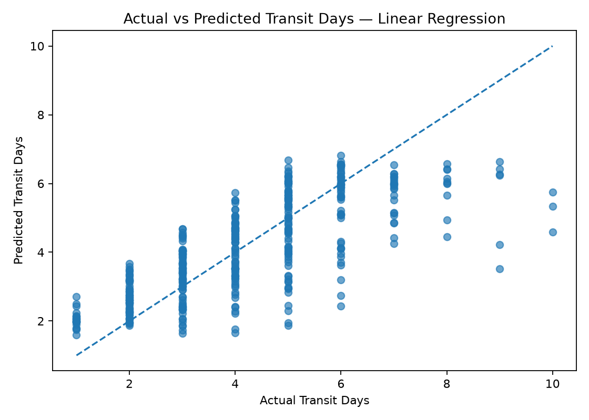
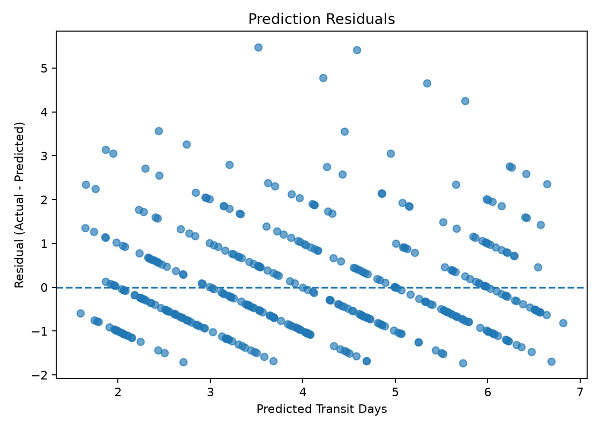

# Week 4 — Predictive Modeling and Optimization in Logistics Systems

**Internship:** Yuvaintern Data Analytics  
**Dataset:** Same logistics shipments dataset used in Week 3  
**Tools:** Python, pandas, NumPy, Matplotlib, scikit-learn

## Objective

Predict shipment transit duration (`Transit_Days`) and use model evaluation to suggest ways to improve logistics planning.

## Dataset and features

The dataset has **2,000 records** and includes origin warehouse, destination, carrier, shipment date, weight, cost, distance, status, and transit days. The target is `Transit_Days`. Predictors are origin, destination, carrier, weight, cost, distance, shipment month, and shipment day of week. `Delivery_Date` and `Status` are excluded from the features to reduce target leakage.

## Workflow

1. Parse shipment dates and create month/day-of-week features.
2. Impute missing numeric and categorical values inside a preprocessing pipeline.
3. One-hot encode categorical variables.
4. Split records into 80% training and 20% testing data.
5. Compare Linear Regression and Random Forest using MAE, RMSE, and R².
6. Visualize model errors and provide logistics recommendations.

## Test-set results

| Model             | MAE (days) | RMSE (days) |    R² |
| ----------------- | ---------: | ----------: | ----: |
| Linear Regression |      0.950 |       1.242 | 0.559 |
| Random Forest     |      0.970 |       1.271 | 0.538 |

Linear Regression has the lower MAE on this held-out test split, so it is selected as the primary model. These results are test-set estimates and are not guaranteed future performance.

## Visualizations

### Model comparison



### Actual vs predicted transit days



### Prediction residuals



## How to run

Keep `predictive_model.py` and `logistics_shipments_dataset.csv` in the same folder.

```bash
pip install pandas numpy matplotlib scikit-learn
python predictive_model.py
```

The script saves `model_evaluation.csv`, `test_set_predictions.csv`, and the three charts under `charts/`.

## Optimization recommendations

- Flag shipments with predicted transit time above the service target.
- Review carrier and warehouse performance alongside distance and cost.
- Investigate records with large prediction errors.
- Improve data quality and periodically retrain/monitor the model.
- Treat these as recommendations, not proof of guaranteed cost savings or an optimized route.

## Files

- `Week4_Predictive_Modeling_and_Optimization_Report.docx` — full report and embedded charts.
- `predictive_model.py` — runnable modelling script.
- `logistics_shipments_dataset.csv` — source data.
- `model_evaluation.csv` — model metrics.
- `test_set_predictions.csv` — held-out test predictions.
- `charts/` — generated visualizations.
